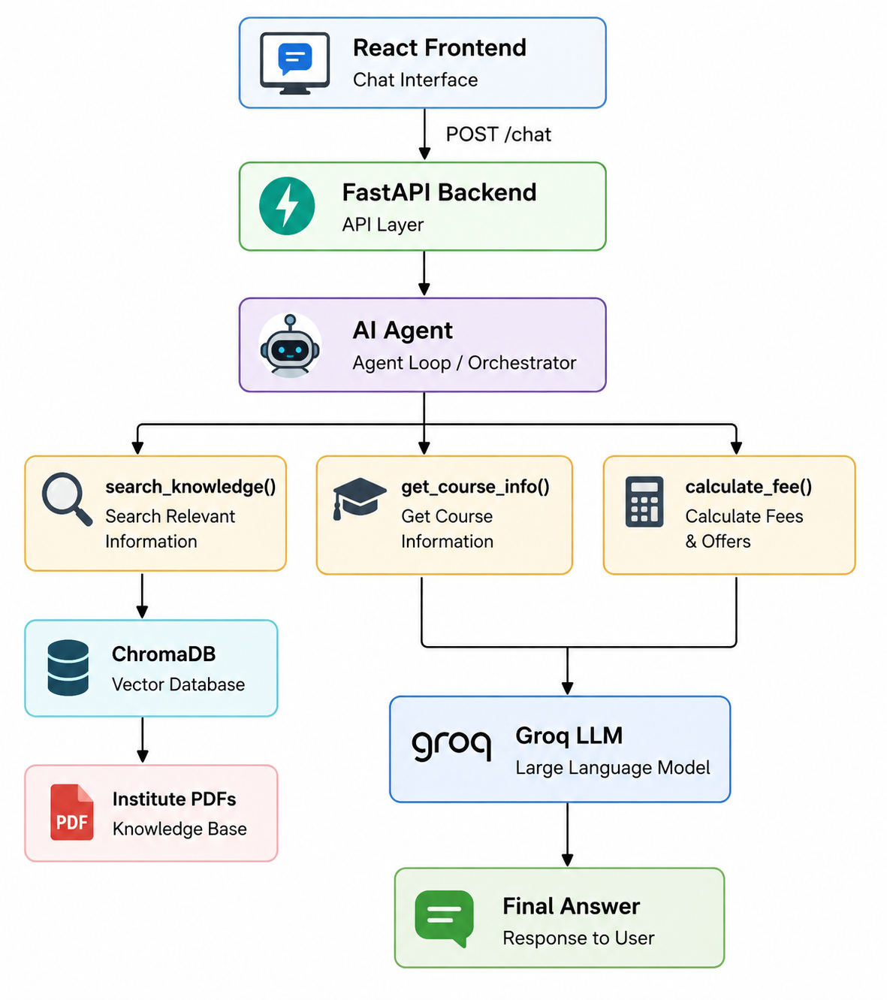
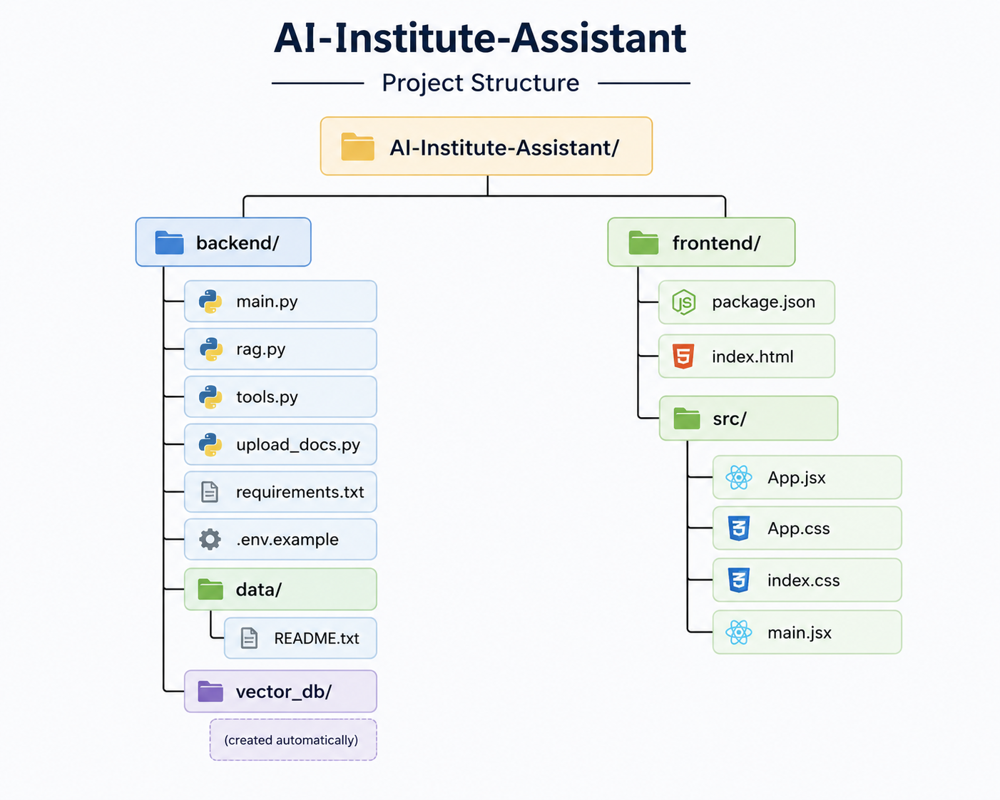
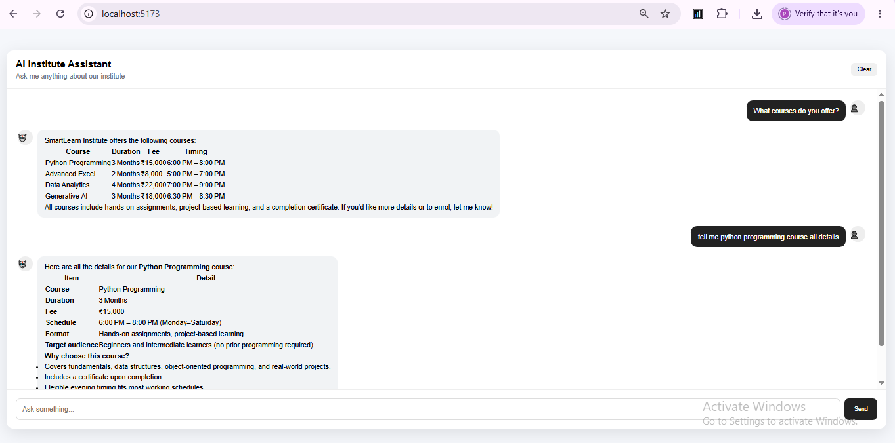

# 🤖 AI Institute Assistant 

A practical AI Institute Assistant built with Python, FastAPI, React, RAG, ChromaDB, Groq, and tool calling.

Version 4 introduces a single tool-using AI agent that can decide which tool to use, execute it, observe the result, and continue until it can answer the user's question. This version also adds conversation memory, relevance-filtered retrieval, and error handling around the LLM and tool-execution layers.

---

### 🚀 Features

- 💬 React chat interface
- ⚡ FastAPI backend
- 🧠 Groq LLM
- 📚 RAG over institute PDF documents
- 🗄️ ChromaDB vector database
- 🔎 Sentence-transformer embeddings
- 🎯 Relevance-threshold filtering on retrieval (rejects low-confidence matches instead of returning irrelevant chunks)
- 🛠️ Tool calling
- 🎓 Course information tool
- 💰 Fee calculation tool
- 📖 Knowledge-search tool
- 🔄 Iterative agent loop with a safety limit
- 💭 Multi-turn conversation memory (client-held history sent with each request)
- 🛡️ Error handling for LLM API failures (rate limits, connection errors) and malformed tool calls
- 📝 Markdown rendering
- 📊 GitHub-style table rendering
- 🌐 CORS support for local React development
- 🔐 Environment variable support for API keys

---

### 🏗️ Architecture



---

### 🛠️ Tech Stack

Frontend

- React
- JavaScript
- Vite
- React Markdown
- CSS

Backend

- Python
- FastAPI
- Uvicorn

AI

- Groq API
- Large Language Model
- Tool Calling
- AI Agent Loop

RAG

- ChromaDB
- Sentence Transformers
- PyPDF
- LangChain Community

---

### 📁 Project Structure



---

### ⚙️ Setup

1. Prerequisites

Install:

- Python 3.10+
- Node.js 18+
- npm
- Groq API key

Important: Keep the API key only in the backend. Never put it in React/frontend code.

---

2. Backend Setup

Open a terminal:

```bash
cd backend
```

Create a virtual environment:

```bash
python -m venv venv
```

Windows:
```bash
venv\Scripts\activate
```

macOS/Linux:
```bash
source venv/bin/activate
```

Install dependencies:

```bash
pip install -r requirements.txt
```

Create `.env` from `.env.example`:

```
GROQ_API_KEY=your_groq_api_key_here
```

---

3. Add Institute Documents

Place your institute PDF documents inside:

```
backend/data/
```

For example:

```
backend/data/courses.pdf
backend/data/fees.pdf
backend/data/timings.pdf
```

Then create the vector database:

```bash
python upload_docs.py
```

This process:

1. Reads the PDFs
2. Extracts the text
3. Splits the text into chunks
4. Creates embeddings
5. Stores the embeddings in ChromaDB

The `vector_db/` directory is created automatically.

---

4. Tune the retrieval relevance threshold (recommended)

Retrieval now filters out low-relevance chunks using a distance-score threshold in `rag.py`. The default (`1.5`) was tuned against this project's sample documents — if you add your own PDFs, re-tune it:

```bash
python test_threshold.py
```

Compare distance scores between clearly relevant and clearly irrelevant test questions, and set `score_threshold` in `rag.py`'s `retrieve_context()` function to a value between the two clusters.

---

5. Start FastAPI

From the `backend` directory:
```bash
uvicorn main:app --reload
```
The API will run at:
```
http://localhost:8000
```

---

6. Start the Frontend

Open another terminal:
```bash
cd frontend
```
Install dependencies:
```bash
npm install
```
Start the development server:
```bash
npm run dev
```
Open the URL shown by Vite, normally:
```
http://localhost:5173
```

---

### 💬 Example Questions

Try questions such as:

- What courses do you offer?
- How much does Python cost?
- What is the fee for Python and Advanced Excel together?
- What are the class timings?
- What is your refund policy?
- How can I contact the institute?
- Follow-up questions like "what about Excel?" after asking about a specific course — conversation history is now preserved within a session.

---

### 🛠️ AI Agent Tools

The agent can choose between three tools.

1. `search_knowledge()`

Searches institute documents using RAG and ChromaDB. Results below the relevance threshold are filtered out — the agent will say it couldn't find the information rather than answering from a weak match.

Example:

What is your refund policy?

---

2. `get_course_info()`

Retrieves information about available courses.

Example:

What courses do you offer?

Tell me about the Python course.

---

3. `calculate_fee()`

Calculates the total fee for selected courses.

Example:

What is the total fee for Python and Advanced Excel?

The agent can retrieve the required course fees and then use the fee-calculation tool.

---

### 🤖 How the AI Agent Works

The key feature of Version 4 is the iterative agent loop, now combined with conversation memory.

```
Conversation History + User Question
      ↓
LLM Understands Request
      ↓
Does it need a tool?
      ↓
     Yes
      ↓
Call Tool
      ↓
Tool Result Returned to LLM
      ↓
Does it need another tool?
      ↓
     Yes
      ↓
Call Another Tool
      ↓
     No
      ↓
Final Answer
```

The backend limits the number of agent steps to prevent an endless tool-calling cycle. If the LLM API call fails (rate limit, connection error) or a tool call raises an unexpected exception, the agent returns a graceful error message instead of crashing the request.

---

### 🔄 Example Agent Flow

For the question:

What is the total fee for Python and Advanced Excel?

The agent can perform:

```
User Question
      ↓
Understand the request
      ↓
get_course_info()
      ↓
Retrieve Python fee
      ↓
get_course_info()
      ↓
Retrieve Advanced Excel fee
      ↓
calculate_fee()
      ↓
Final Answer
```

This demonstrates how an AI agent can use multiple tools in sequence before generating the final response.

---

### 💭 Conversation Memory

The frontend sends the full message history with every request, and the backend threads it into the LLM's message list before the new question. This lets the agent resolve follow-up questions like "what about Excel?" after a prior question about Python, without repeating full context each time.

Note: history is held client-side per browser session, not persisted server-side across sessions or restarts. A future version could move this to a database-backed session store (see Future Improvements).

---

### 📊 Technologies

Technology| Purpose
Python| Backend and AI logic
FastAPI| REST API
React| Frontend
Vite| Frontend development server
Groq| LLM inference
ChromaDB| Vector database
Sentence Transformers| Text embeddings
LangChain Community| PDF/vector integrations
PyPDF| PDF loading
React Markdown| Markdown rendering

---

### 🔐 Security

Do not commit your real API key.

Never upload:

```
backend/.env
```

Use:

```
backend/.env.example
```

with:

```
GROQ_API_KEY=your_groq_api_key_here
```

Recommended `.gitignore`:

```
.env
venv/
__pycache__/
*.pyc
node_modules/
dist/
backend/vector_db/
```

---

### 🎯 Learning Value

Version 4 demonstrates how to build a practical tool-using AI agent with production-minded refinements.

The project covers:

- LLM integration
- RAG with relevance filtering
- Vector databases
- Embeddings
- Tool calling
- Agent loops
- Multiple tool execution
- Multi-turn conversation handling
- Error handling and graceful degradation
- FastAPI backend development
- React frontend development
- Environment-based configuration

---

### 🔮 Future Improvements

Possible future extensions include:

- 🔐 User authentication
- 🗄️ PostgreSQL database
- 💾 Server-side persistent memory (across sessions/restarts, not just per-browser-session)
- 📊 Admin dashboard
- 👨‍🎓 Student management
- 💰 Fee tracking
- 📋 Attendance tracking
- 📞 Lead management
- 🔔 Automated follow-ups
- 📈 Institute analytics
- ☁️ Cloud deployment
- 🔍 Observability and structured logging
- 🤖 Multi-agent architecture

---

### 📸 Screenshot



---

### 📌 Project Status

Single AI Agent with Tool Calling, RAG, Relevance Filtering, and Multi-Turn Memory

A learning and portfolio project demonstrating how a chatbot can use RAG, tools, an iterative agent loop, and conversation context to answer institute-related questions reliably.